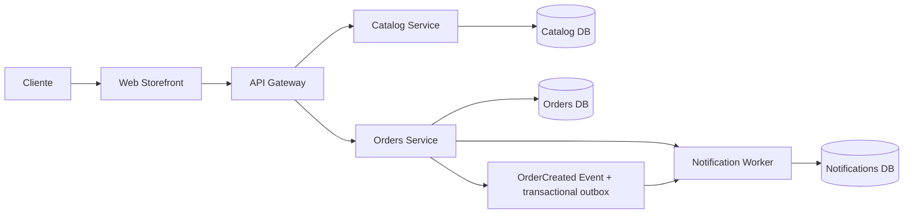

# Wiki técnica de MileShop Platform

## 1. Propósito

Esta wiki documenta la realidad técnica y funcional verificable del sistema que estamos construyendo. Distingue el runtime implementado de las capacidades planificadas para evitar que un diagrama futuro se interprete como una funcionalidad disponible.

No es una wiki de estilo genérico ni un repositorio de frases vacías. Su función es dejar documentado el modelo de negocio, la estructura del sistema, las decisiones de arquitectura y los estándares que sostienen la plataforma en producción.

## 2. Qué responde esta wiki

Esta wiki responde a estas preguntas:

1. ¿Qué negocio está soportando la plataforma?
2. ¿Qué actores intervienen y qué hacen?
3. ¿Cómo funciona el flujo de catálogo, registro y compra?
4. ¿Cómo está organizada la arquitectura por dominios y servicios?
5. ¿Qué estándares técnicos, de calidad y operación deben cumplirse?
6. ¿Qué decisiones no pueden cambiarse sin afectar el modelo del negocio?

## 3. Cobertura del conocimiento

- [architecture-overview.md](architecture-overview.md) — arquitectura implementada, contratos, datos, eventos, despliegue y objetivos pendientes
- [product-backlog-v1.md](product-backlog-v1.md) — estado de capacidades, trabajo P0 y objetivos posteriores
- [engineering-standards.md](engineering-standards.md) — principios SOLID, quality gates y estándares de ingeniería
- [../PLAN-V1-2026.md](../PLAN-V1-2026.md) — roadmap y criterios de entrega para la v1
- [../RELEASE-PLAYBOOK.md](../RELEASE-PLAYBOOK.md) — release, hotfix y rollback
- [../STACK_OPERATIONS.md](../STACK_OPERATIONS.md) — runtime, ownership y operación del stack
- [../LOCAL_STACK_RUNBOOK.md](../LOCAL_STACK_RUNBOOK.md) — ejecución local y smoke tests

## 4. Sistema implementado hoy

## 5. Diagramas que forman la base del proyecto

La wiki debe mantener explícitamente estos diagramas y modelos:

- contexto y componentes implementados;
- interfaces HTTP reales;
- secuencia real de compra;
- datos Prisma y ownership;
- estado actualmente soportado;
- evento y deduplicación;
- despliegue local y migraciones;
- matriz de objetivos pendientes y evidencia.

## 6. Regla de mantenimiento

Cada cambio de negocio, flujo, servicio o contrato debe reflejarse aquí.

Esto incluye:

- nuevas categorías o reglas de merchandising cuando exista implementación;
- cambios en datos del cliente requeridos para compra;
- nuevas promociones, descuentos o destacables cuando exista su modelo;
- cambios en el estado del pedido;
- nueva integración con WhatsApp u otros canales;
- cambios de contrato entre servicios;
- cambios de runtime, release o operación.

Si la decisión no está documentada, no se puede considerar resuelta.

## 7. Filtros de contenido que no se aceptan

La wiki no acepta contenido que no responda al negocio, al dominio o a la operación real del proyecto. En particular, se descarta:

- lenguaje comercial genérico o promocional sin contexto de producto;
- diagramas sin responsable real de dominio o sin flujo verificable;
- documentos que mezclan aspiraciones futuras con decisiones ya tomadas;
- textos que repiten información sin aportar criterio ni evidencia;
- propuestas que no mejoren catálogo, identidad, pedido, notificación o operación del sistema.

## 8. Principios del proyecto

- cada dominio tiene ownership claro;
- el catálogo no comparte estado con el pedido;
- la compra requiere contexto real del cliente;
- los precios visibles deben ser los precios pactados;
- la administración editorial y comercial son objetivos pendientes, no capacidades implementadas;
- las notificaciones son un flujo operativo; WhatsApp permanece como integración objetivo hasta tener adaptador implementado;
- el código debe describir el negocio, no al revés;
- la documentación es parte del producto, no un apéndice.

## 8. Criterio de uso

Esta wiki debe leerse en este orden:

1. arquitectura general;
2. flujos del negocio;
3. estándares y principios;
4. roadmap y entregables v1;
5. operación y release;
6. decisiones técnicas a medida que el proyecto madura.

## 9. Conclusión

MileShop Platform es actualmente un sistema de catálogo, carrito, pedidos idempotentes y notificaciones con identidad persistente de clientes. El outbox transaccional de pedidos entrega `OrderCreated.v1` al worker por HTTP con reintentos y deduplicación; no existe broker externo ni adaptador de notificación de negocio. La autoridad editorial y los canales externos siguen siendo objetivos documentados, no capacidades disponibles. La wiki deja esos límites, flujos y decisiones explícitos para evitar que el roadmap se confunda con el runtime.
