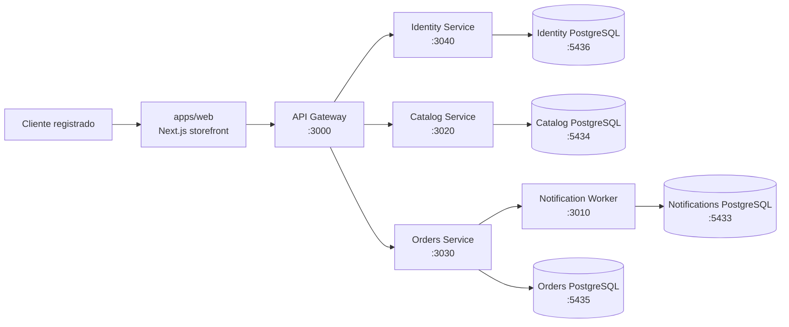
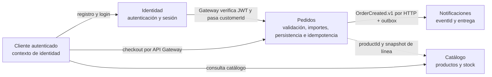
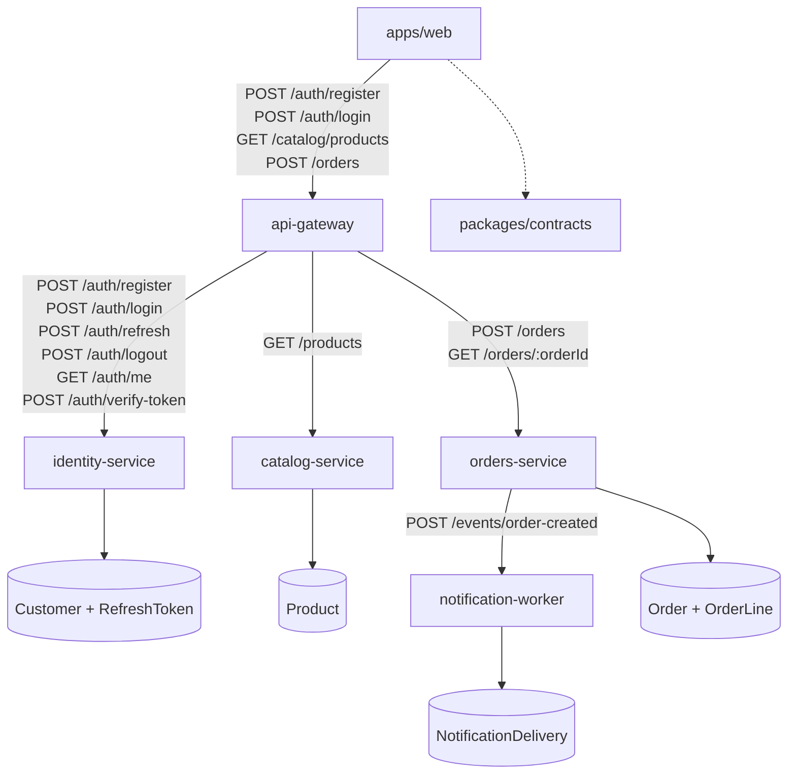
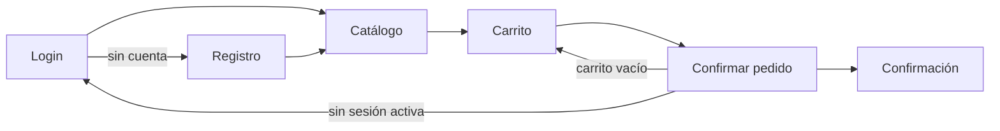
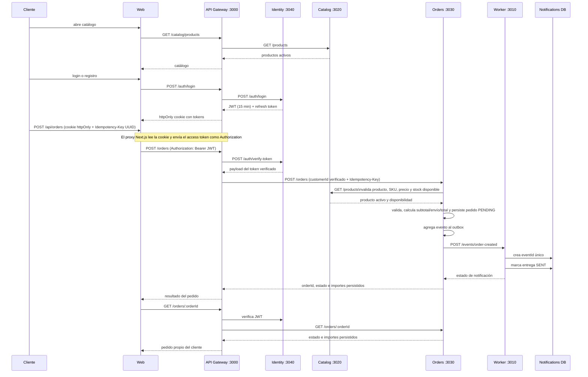
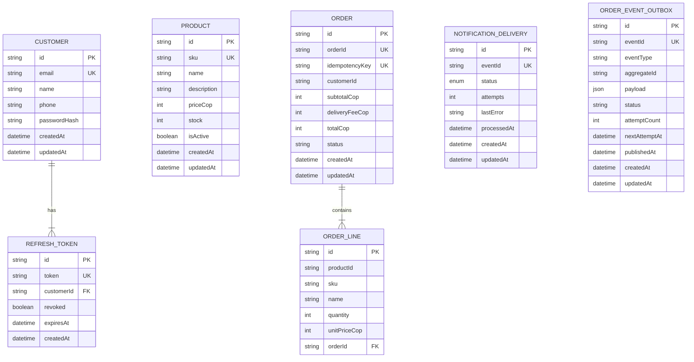
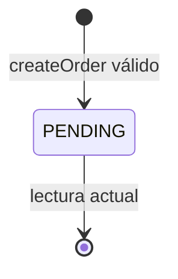
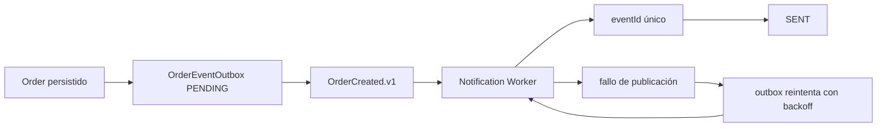
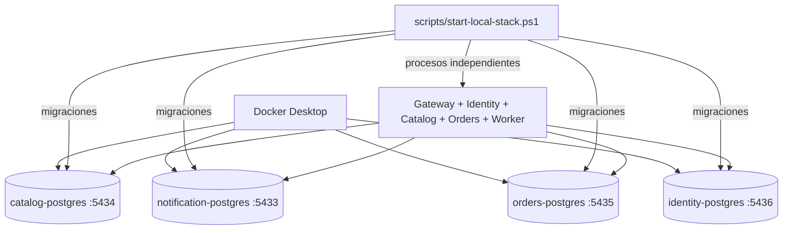

# Arquitectura de MileShop Platform

## 1. Regla de lectura

Este documento describe primero el estado implementado y verificable en el repositorio. Todo elemento marcado como `objetivo` es diseño pendiente y no debe interpretarse como una capacidad disponible.

La fuente de evidencia es:

- `apps/web` para storefront, carrito, login, registro y checkout;
- `services/api-gateway` para la entrada HTTP pública y la composición;
- `services/identity-service` para autenticación, sesión y perfiles de cliente;
- `services/catalog-service` para productos y stock;
- `services/orders-service` para la persistencia y las reglas del pedido;
- `services/notification-worker` para deduplicación y procesamiento de `OrderCreated.v1`;
- los schemas Prisma y las migraciones de cada servicio para el modelo de datos;
- los scripts de `scripts/` para el runtime local.

## 2. Estado implementado

### 2.1 Contexto del sistema

No existe actualmente un panel administrativo ni un adaptador de WhatsApp en este monorepo.

### 2.1.1 Mapa de contextos DDD actual

La relación punteada representa una consulta HTTP del servicio de pedidos al catálogo para validar estado, SKU, precio y stock. El pedido almacena un snapshot de las líneas y no crea una foreign key entre bases de datos. El `customerId` que llega al servicio de pedidos está verificado por el servidor mediante `AuthMiddleware` en el gateway.

### 2.2 Componentes y ownership

Ownership actual:

| Área | Responsable | Evidencia |
| --- | --- | --- |
| Identidad y sesión | `identity-service` | `services/identity-service/prisma/schema.prisma` |
| Productos activos | `catalog-service` | `services/catalog-service/prisma/schema.prisma` |
| Pedido y líneas | `orders-service` | `services/orders-service/prisma/schema.prisma` |
| Outbox y reintentos de publicación | `orders-service` | `OrderEventOutbox`, `eventId` único y recuperación periódica |
| Deduplicación de entrega | `notification-worker` | `NotificationDelivery` y `eventId` único |
| Composición pública | `api-gateway` | `gateway.controller.ts` y `orders.service.ts` |
| Checkout y autenticación web | `apps/web` | `catalog-shell.tsx`, `login/page.tsx` y `register/page.tsx` |

### 2.3 Interfaces HTTP implementadas

| Servicio | Endpoint | Resultado |
| --- | --- | --- |
| Gateway | `GET /healthz` | estado del gateway |
| Gateway | `GET /catalog/products` | catálogo activo compuesto desde catálogo |
| Gateway | `POST /orders` | requiere JWT y `Idempotency-Key`; delega la creación y publicación al servicio de pedidos |
| Gateway | `GET /orders/:orderId` | requiere JWT y solo retorna pedidos del cliente autenticado |
| Gateway | `POST /auth/register` | proxy hacia identity-service, crea cuenta |
| Gateway | `POST /auth/login` | proxy hacia identity-service, devuelve tokens |
| Gateway | `POST /auth/refresh` | proxy hacia identity-service, renueva access token |
| Gateway | `POST /auth/logout` | proxy hacia identity-service, invalida refresh token |
| Gateway | `GET /auth/me` | proxy hacia identity-service, perfil del cliente autenticado |
| Identity | `GET /healthz` | estado del servicio de identidad |
| Identity | `POST /auth/register` | crea CUSTOMER con contraseña hasheada |
| Identity | `POST /auth/login` | valida credenciales, emite JWT + refresh token |
| Identity | `POST /auth/refresh` | valida refresh token opaco, emite nuevo JWT |
| Identity | `POST /auth/logout` | invalida refresh token en DB |
| Identity | `GET /auth/me` | retorna perfil del cliente desde JWT |
| Identity | `POST /auth/verify-token` | verifica JWT y retorna payload (uso interno del gateway) |
| Catalog | `GET /healthz` | estado del catálogo |
| Catalog | `GET /products` | productos activos ordenados por nombre |
| Orders | `GET /healthz` | estado de pedidos |
| Orders | `POST /orders` | valida líneas contra catálogo, calcula subtotal/envío/total, persiste en `PENDING` y devuelve el evento; requiere clave de idempotencia |
| Orders | `GET /orders/:orderId` | recupera pedido, estado, importes y líneas |
| Worker | `GET /healthz` | estado de notificaciones |
| Worker | `POST /events/order-created` | reclama, deduplica y procesa el evento |

### 2.3.1 Flujo de navegación implementado

Este es el flujo de cliente que existe hoy en `apps/web`. No se dibuja un flujo administrativo porque todavía no existe `Admin Console` en este proyecto.

### 2.4 Secuencia real de compra

`orders-service` es propietario de la creación del pedido, su clave de idempotencia y el outbox persistente. El pedido, sus líneas y el evento de outbox se guardan en una transacción PostgreSQL; la publicación HTTP al worker comienza después del commit. Si la publicación falla, el pedido sigue en `PENDING` y el servicio reintenta con backoff hasta ocho intentos; el checkout consulta el estado real y no presupone confirmación.

### 2.5 Modelo de datos implementado

`productId` en `OrderLine` es una referencia de negocio almacenada como snapshot; no existe foreign key entre la base de catálogo y la base de pedidos. `CUSTOMER` y `REFRESH_TOKEN` pertenecen a la base de datos de identidad (`:5436`), aislada de las demás. No hay tablas implementadas para direcciones, promociones, banners, variantes o administradores.

### 2.6 Estado del pedido implementado

El estado inicial es `PENDING`. Aunque el tipo de dominio incluye `CONFIRMED` y `CANCELLED`, todavía no existen endpoints ni transiciones implementadas para confirmar o cancelar. La publicación del evento no cambia el estado del pedido. Estados adicionales como `READY_FOR_DISPATCH` y `COMPLETED` son objetivo, no comportamiento actual.

### 2.7 Evento `OrderCreated.v1`

El evento se construye desde `services/orders-service/src/orders.service.ts`; el pedido, sus líneas y la fila outbox se persisten en una única transacción antes de cualquier envío HTTP. La outbox registra el payload, el número de intentos y el próximo reintento; tras ocho intentos fallidos requiere intervención. El worker deduplica mediante `NotificationDelivery.eventId`. No hay broker externo.

### 2.8 Despliegue local

El script inicia migraciones, lanza procesos independientes con logs en `.local-stack/logs`, espera los cinco `/healthz` y ejecuta el smoke test del catálogo. `scripts/stop-local-stack.ps1` detiene listeners y Postgres.

### 2.9 Pipeline de CI implementado

```mermaid
flowchart LR
    Change[push o pull request\nmain / develop] --> Install[npm ci]
    Install --> Audit[npm audit --audit-level=high]
    Audit --> Generate[npm run db:generate]
    Generate --> Typecheck[npm run typecheck]
    Typecheck --> Lint[npm run lint]
    Lint --> Test[npm run test]
    Test --> Build[npm run build]
    Build --> Compose[docker compose config]
    Compose --> Green[release-quality verde]
```

La pipeline real está en `.github/workflows/ci.yml`. Valida calidad y compilación, pero todavía no despliega a cloud ni promueve automáticamente una release.

## 3. Diseño objetivo pendiente

Estos elementos pertenecen al producto planificado y no deben aparecer en los diagramas de estado actual hasta que exista código, schema, contrato y prueba:

- panel administrativo y ownership editorial;
- promociones, banners, notas, categorías y variantes;
- estados avanzados del pedido y sus transiciones;
- adaptador real de WhatsApp;
- broker externo;
- despliegue remoto, observabilidad y backup productivos.

## 4. Matriz de trazabilidad documental

| Diagrama | Pregunta que responde | Evidencia requerida |
| --- | --- | --- |
| Contexto | ¿Qué existe alrededor del sistema? | workspaces y runtime |
| Componentes | ¿Quién posee cada responsabilidad? | módulos, controllers y Prisma |
| Interfaces | ¿Qué contratos HTTP existen? | controllers y clientes |
| Secuencia | ¿Qué ocurre en una compra? | web, gateway, orders y worker |
| Datos | ¿Qué tablas y relaciones existen? | `schema.prisma` y migraciones |
| Estados | ¿Qué transiciones están implementadas? | dominio, endpoints y tests |
| Evento | ¿Cómo se deduplica una notificación? | contrato, worker y store |
| Despliegue | ¿Cómo se ejecuta localmente? | Docker Compose y scripts |

Un diagrama que no pueda apuntar a una de estas evidencias se marca como objetivo o se elimina.
