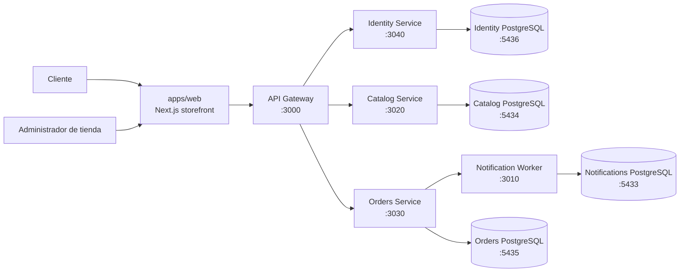
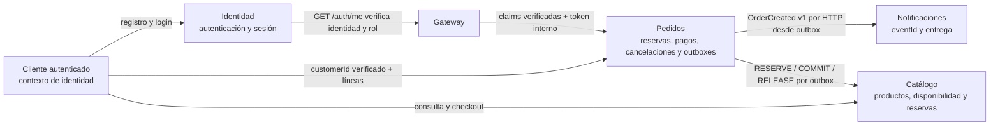
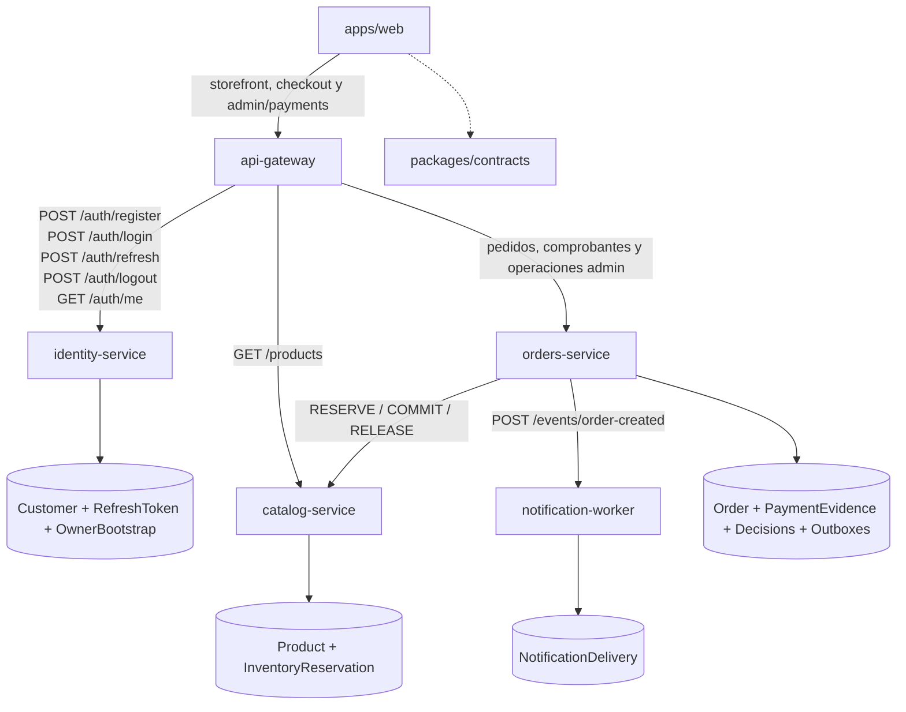
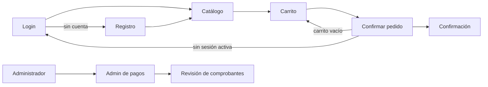
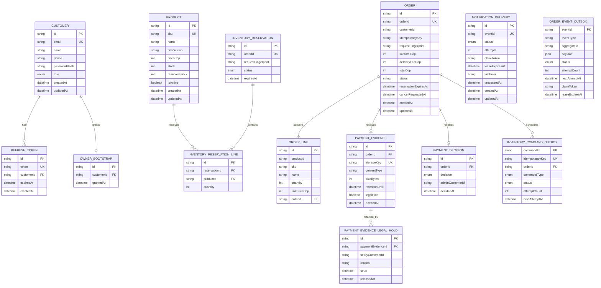
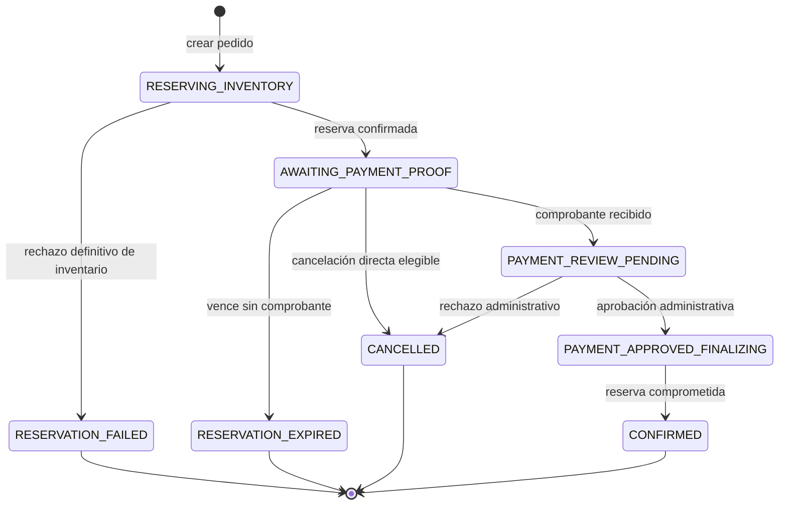
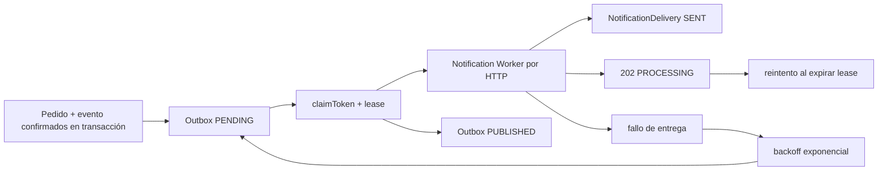
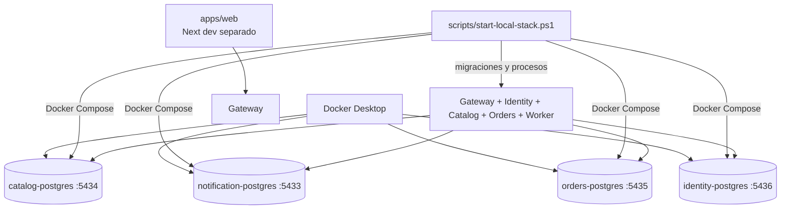

# Arquitectura de MileShop Platform

## 1. Regla de lectura

Este documento describe primero el estado implementado y verificable en el repositorio. Todo elemento marcado como `objetivo` es diseño pendiente y no debe interpretarse como una capacidad disponible.

La fuente de evidencia es:

- `apps/web` para storefront, API routes de sesión, checkout y revisión administrativa de pagos;
- `services/api-gateway` para la entrada HTTP pública y la composición;
- `services/identity-service` para autenticación, sesión y perfiles de cliente;
- `services/catalog-service` para productos, disponibilidad y reservas atómicas de inventario;
- `services/orders-service` para el ciclo de vida del pedido, outboxes y revisión/retención de comprobantes;
- `services/notification-worker` para deduplicación y procesamiento de `OrderCreated.v1`;
- los schemas Prisma y las migraciones de cada servicio para el modelo de datos;
- `CONTRIBUTING.md` y `docs/STACK_OPERATIONS.md` para el runtime local.

## 2. Estado implementado

### 2.1 Contexto del sistema



El panel `/admin/payments` permite revisar comprobantes y resolver pagos; no existe un adaptador de WhatsApp ni un panel de administración del catálogo.

### 2.1.1 Mapa de contextos DDD actual



Los servicios se comunican mediante HTTP; las bases de datos no se comparten. Gateway valida identidad y rol con Identity y reenvía el contexto verificado mediante el canal interno autenticado. Orders persiste snapshots de producto y comandos durables; Catálogo es autoridad de la reserva.

### 2.2 Componentes y ownership



Ownership actual:

| Área | Responsable | Evidencia |
| --- | --- | --- |
| Identidad, sesión y rol | `identity-service` | `services/identity-service/prisma/schema.prisma` |
| Productos y reservas de inventario | `catalog-service` | `services/catalog-service/prisma/schema.prisma` |
| Pedidos, comprobantes, decisiones, comandos y eventos outbox | `orders-service` | `services/orders-service/prisma/schema.prisma` |
| Entrega idempotente con lease | `notification-worker` | `NotificationDelivery` y `eventId` único |
| Composición pública | `api-gateway` | `gateway.controller.ts` y `orders.service.ts` |
| Checkout y autenticación web | `apps/web` | `catalog-shell.tsx`, `login/page.tsx` y `register/page.tsx` |

### 2.3 Interfaces HTTP implementadas

| Servicio | Endpoint | Resultado |
| --- | --- | --- |
| Gateway | `GET /healthz` | estado del gateway |
| Gateway | `GET /catalog/products` | catálogo activo compuesto desde catálogo |
| Gateway | `POST /orders` | valida JWT, exige `Idempotency-Key` y delega la creación |
| Gateway | `GET /orders/:orderId` | recupera el pedido propio del cliente autenticado |
| Gateway | `POST /orders/:orderId/cancel` | cancela un pedido elegible antes del comprobante |
| Gateway | `POST /orders/:orderId/cancellation-request` | solicita cancelación para revisión administrativa |
| Gateway | `POST /orders/:orderId/payment-evidence` | recibe el comprobante privado del cliente |
| Gateway | `GET /admin/payments` | lista pagos pendientes para `STORE_ADMIN` |
| Gateway | `POST /admin/payments/:orderId/approve` / `reject` | registra la decisión administrativa |
| Gateway | `GET` / `POST /admin/payments/:orderId/evidence` | descarga o elimina la copia privada del comprobante |
| Gateway | `/admin/cancellation-requests/*` | revisa solicitudes y registra resolución/reembolso externo |
| Gateway | `POST /auth/register` | proxy hacia identity-service, crea cuenta |
| Gateway | `POST /auth/login` | proxy hacia identity-service, devuelve tokens |
| Gateway | `POST /auth/refresh` | proxy hacia identity-service, renueva access token |
| Gateway | `POST /auth/logout` | proxy hacia identity-service, invalida refresh token |
| Gateway | `GET /auth/me` | proxy hacia identity-service, perfil del cliente autenticado |
| Identity | `GET /healthz` | estado del servicio de identidad |
| Identity | `POST /auth/register` | crea CUSTOMER con contraseña hasheada |
| Identity | `POST /auth/login` | valida credenciales, emite JWT + refresh token |
| Identity | `POST /auth/refresh` | valida refresh token opaco, emite nuevo JWT |
| Identity | `POST /auth/logout` | invalida refresh token en DB |
| Identity | `GET /auth/me` | retorna perfil del cliente desde JWT |
| Catalog | `POST /internal/inventory/reservations` | reserva inventario de forma atómica e idempotente |
| Catalog | `POST /internal/inventory/reservations/commit` | compromete una reserva al aprobar el pago |
| Catalog | `POST /internal/inventory/reservations/release` | libera reserva al cancelar, vencer o rechazar |
| Catalog | `GET /healthz` | estado del catálogo |
| Catalog | `GET /products` | productos activos ordenados por nombre |
| Orders | `GET /healthz` | estado de pedidos |
| Orders | `POST /orders` | persiste pedido, evento y comando de reserva en transacción |
| Orders | `/orders/:orderId/payment-evidence` | carga y descarga evidencia según identidad/propiedad |
| Orders | `/admin/payments/*` | cola, detalle, decisión y retención de evidencia para administradores |
| Orders | `/admin/cancellation-requests/*` | revisión de cancelaciones y registro de gestión de reembolso |
| Worker | `GET /healthz` | estado de notificaciones |
| Worker | `POST /events/order-created` | reclama con lease, deduplica y procesa el evento |

### 2.3.1 Flujo de navegación implementado



El storefront y la revisión de pagos existen en `apps/web`. El administrador de tienda usa el rol `STORE_ADMIN`; no existe un editor administrativo de catálogo.

### 2.4 Secuencia real de compra

```mermaid
sequenceDiagram
    participant C as Cliente
    participant W as Next.js API routes
    participant G as API Gateway :3000
    participant ID as Identity :3040
    participant CAT as Catalog :3020
    participant ORD as Orders :3030
    participant N as Worker :3010
    participant Admin as Administradora
    participant ODB as Orders DB
    participant NDB as Notifications DB

    C->>W: abre catálogo
    W->>G: GET /catalog/products
    G->>CAT: GET /products
    CAT-->>G: productos activos
    G-->>W: catálogo
    C->>W: login o registro
    W->>G: POST /auth/login
    G->>ID: POST /auth/login
    ID-->>G: access token + refresh token
    G-->>W: respuesta de autenticación
    W-->>C: Set-Cookie httpOnly
    C->>W: confirma carrito con cookie de sesión
    W->>G: POST /orders (Authorization: Bearer JWT)
    G->>ID: GET /auth/me con el access token
    ID-->>G: customerId, email y rol verificados
    G->>ORD: POST /orders (customerId verificado)
    ORD->>CAT: GET /products para validar producto y precio
    CAT-->>ORD: producto activo y disponibilidad
    ORD->>ORD: valida payload y calcula subtotal, envío y total
    ORD->>ODB: transacción: pedido, líneas, OrderEventOutbox y RESERVE PENDING
    ORD->>CAT: worker de inventario envía RESERVE
    CAT->>CAT: reserva stock de forma atómica
    CAT-->>ORD: reserva confirmada
    ORD->>ODB: actualiza estado AWAITING_PAYMENT_PROOF
    ORD->>ODB: reclama evento con lease y token
    ORD->>N: POST /events/order-created
    alt worker envía o ya había enviado
        N->>NDB: crea o reclama eventId con lease
        N->>NDB: envía y marca SENT
        N-->>ORD: sent o duplicate
        ORD->>ODB: marca evento PUBLISHED
    else worker ocupado, indisponible o timeout
        N-->>ORD: 202 processing o error
        ORD->>ODB: libera claim y agenda reintento con backoff
    end
    ORD-->>G: pedido persistido
    G-->>W: orderId, total y evento
    opt repetición del mismo checkout
        W->>G: POST /orders con el mismo Idempotency-Key
        G->>ID: verifica token y rol
        G->>ORD: reenvía comando autenticado
        ORD->>ODB: busca cliente + clave
        ODB-->>ORD: pedido original
        ORD-->>G: devuelve pedido sin crear otro evento
        G-->>W: mismo orderId
    end
    C->>W: carga comprobante antes del vencimiento
    W->>G: POST /orders/:orderId/payment-evidence
    G->>ORD: persiste archivo privado y metadatos
    ORD->>ODB: PAYMENT_REVIEW_PENDING
    Admin->>W: revisa pago en /admin/payments
    W->>G: POST /admin/payments/:orderId/approve o /reject
    G->>ORD: registra decisión de STORE_ADMIN
    ORD->>CAT: COMMIT si se aprueba; RELEASE si se rechaza
```

La clave de idempotencia se conserva en `sessionStorage` durante reintentos del mismo carrito. `orders-service` guarda pedido, líneas, evento y comando de reserva en la transacción inicial. El outbox de inventario reintenta comandos durables e idempotentes; la reserva tiene vencimiento, y cancelar, vencer o rechazar libera unidades. Aprobar compromete la reserva. El outbox de eventos reintenta con backoff; la entrega es al menos una vez y `notification-worker` deduplica por `eventId`.

### 2.5 Modelo de datos implementado



`productId` en `OrderLine` es una referencia de negocio almacenada como snapshot; no existe foreign key entre bases de catálogo y pedidos. `CUSTOMER`, `REFRESH_TOKEN` y `OWNER_BOOTSTRAP` pertenecen a Identity (`:5436`); las tablas de reservas pertenecen a Catalog (`:5434`); pagos y comandos pertenecen a Orders (`:5435`). En la base de Catálogo, `stock` es la existencia física y `reservedStock` la parte reservada; las respuestas públicas exponen las unidades disponibles. No hay tablas para direcciones, promociones, banners, variantes o edición administrativa de catálogo.

### 2.6 Estado del pedido implementado



El estado se persiste como texto en Orders y el dominio restringe las transiciones conocidas. Las solicitudes de cancelación tras subir comprobante son metadatos de revisión; no cambian inmediatamente el estado del pedido. El reembolso, si aplica, se gestiona fuera del sistema y su referencia queda registrada por el administrador.

### 2.7 Evento `OrderCreated.v1`



El evento se construye y persiste en `services/orders-service`. El worker deduplica mediante `NotificationDelivery.eventId` y evita reclamar de nuevo mientras exista un lease vigente. El transporte sigue siendo HTTP; no se utiliza un broker externo.

### 2.8 Despliegue local



El script inicia los cuatro PostgreSQL, aplica migraciones, lanza procesos backend independientes con logs en `.local-stack/logs`, espera los cinco `/healthz` y ejecuta un smoke test del catálogo. El storefront Next.js se inicia aparte. `scripts/stop-local-stack.ps1` detiene procesos que escuchan en los puertos predeterminados y baja los contenedores: verifica primero los PID, especialmente si otro workspace de MileShop está activo.

### 2.9 Pipeline de CI implementado

```mermaid
flowchart LR
    Change[push o pull request\nmain / develop] --> Install[npm ci]
    Install --> Audit[npm audit --audit-level=high]
    Audit --> Generate[npm run db:generate]
    Generate --> Typecheck[npm run typecheck]
    Typecheck --> Lint[npm run lint]
    Lint --> Test[npm run test]
    Test --> Build[npm run build]
    Build --> Compose[docker compose config]
    Compose --> Stack[Compose + migraciones + seed]
    Stack --> Smoke[servicios + compra autenticada + deduplicación]
    Smoke --> Green[release-quality verde]
```



La pipeline real está en `.github/workflows/ci.yml`. Además de calidad y compilación, levanta una stack efímera y verifica el flujo de compra autenticado con un cliente sintético. No despliega a cloud ni promueve automáticamente una release.

## 3. Diseño objetivo pendiente

Estos elementos pertenecen al producto planificado y no deben aparecer en los diagramas de estado actual hasta que exista código, schema, contrato y prueba:

- administración editorial del catálogo;
- promociones, banners, notas, categorías y variantes;
- preparación de despacho y finalización logística del pedido;
- adaptador real de WhatsApp;
- broker externo (el productor ya dispone de outbox transaccional y usa HTTP);
- despliegue remoto, observabilidad y backup productivos.

## 4. Matriz de trazabilidad documental

| Diagrama | Pregunta que responde | Evidencia requerida |
| --- | --- | --- |
| Contexto | ¿Qué existe alrededor del sistema? | workspaces y runtime |
| Componentes | ¿Quién posee cada responsabilidad? | módulos, controllers y Prisma |
| Interfaces | ¿Qué contratos HTTP existen? | controllers y clientes |
| Secuencia | ¿Qué ocurre en una compra? | web, gateway, orders y worker |
| Datos | ¿Qué tablas y relaciones existen? | `schema.prisma` y migraciones |
| Estados | ¿Qué transiciones están implementadas? | dominio, endpoints y tests |
| Evento | ¿Cómo se deduplica una notificación? | contrato, worker y store |
| Despliegue | ¿Cómo se ejecuta localmente? | Docker Compose y scripts |

Un diagrama que no pueda apuntar a una de estas evidencias se marca como objetivo o se elimina.
